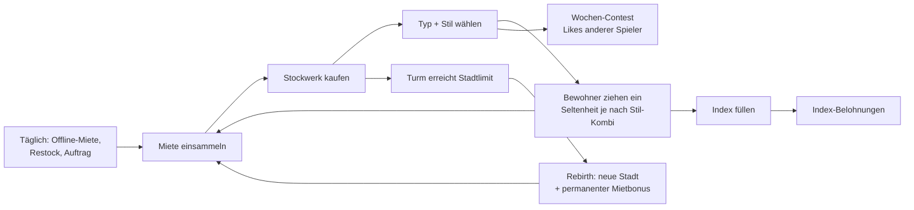

# Build a Skyscraper – Roblox-Spielkonzept

> **Testprompt:** „Ich hab ne Idee für ein Roblox-Spiel: Man ist Architekt und baut Gebäude in einer Stadt – je cooler und größer die Gebäude, desto mehr Bewohner ziehen ein und zahlen Miete. Wir sind zu zweit (ich script in Luau seit einem Jahr, mein Kumpel baut in Blender). Kannst du daraus ein komplettes Spielkonzept machen?“

> **Annahmen** (nicht genannt, begründet gewählt):
> - Zielgruppe **9–14** (Kernsegment von Tycoons/Simulatoren; ermöglicht Label *Minimal* → auch für Roblox Kids/Select sichtbar).
> - **Multiplayer**-Server mit 8 Spielern, jeder mit eigenem Grundstück (Tycoon-Standard).
> - **Budget ≈ 0 €** für Ads zum Launch; Marketing über TikTok/Creator.
> - Team: 1 Scripter (1 Jahr Luau), 1 3D-Artist → Scope für **8–10 Wochen bis Soft-Launch**.

---

## Reality-Check

**Was gut zu Roblox passt**
- **Sichtbar wachsende Basis** ist der Kern der Tycoon-Faszination – ein Turm, der in den Himmel wächst, ist auf jedem Thumbnail und in jedem Clip sofort lesbar (vgl. Tycoon-Loop, `core-loops.md`).
- **Bewohner zahlen Miete = Passiveinkommen** → identisch zur Mechanik von Steal a Brainrot (Charaktere in der Basis erzeugen Geld) und damit bewährt.
- **3D-Artist im Team** ist ein echter Vorteil: Fassaden, Dächer, Deko-Module sind genau der Content, den ein Bau-Spiel endlos braucht – und modulare Assets sind perfekt für wöchentliche Updates.
- „Je cooler, desto mehr“ → **Bewertung durch andere Spieler** ist ein bewährtes Viral-Format (Dress to Impress: Thema → gestalten → bewerten).

**Was nicht (so) passt**
- **Freies Bauen auf Mobile ist schwer.** ~80 % der Roblox-Aktivität ist mobil [Q: Roblox-Zahlen 2024 via pocketgamer.biz]. Ein Bloxburg-artiger Freiform-Baumodus (Wände ziehen, Rotation, Feinplatzierung) ist mit Touch frustrierend und für 9–12-Jährige zu komplex – und für einen 1-Jahr-Scripter ein Monate-Projekt.
- **„Cool“ ist nicht messbar.** Das Spiel braucht eine klare, sichtbare Regel, warum ein Gebäude mehr Bewohner anzieht – sonst versteht kein Kind den Loop.
- **„Stadt bauen“ (SimCity) ist zu groß.** Verkehr, Zonen, Infrastruktur = komplexe Systeme mit wenig Clip-Wert auf Roblox.
- **Rein friedlicher Tycoon** hat schwaches D7: Klassische Tycoons sind nach 30–60 Min „fertig“ (`core-loops.md` B).

**Nächste existierende Spiele**
| Spiel | Ähnlichkeit | Unterschied zu deiner Idee |
|---|---|---|
| Welcome to Bloxburg | Bauen, Häuser, Ästhetik | Freiform-Bau, Roleplay-Fokus, PC-lastig |
| Klassische Tycoons (Button-Pfad) | Basis wächst, Einkommen | Kein Gestaltungsspielraum, kein Sammel-Layer |
| Steal a Brainrot | Charaktere in Basis erzeugen Geld | PvP-Diebstahl, Meme-Thema |
| Dress to Impress | Thema + gestalten + bewerten | Mode statt Gebäude, keine Langzeit-Basis |

**Unique Hook:** *Du baust einen Wolkenkratzer Stockwerk für Stockwerk – und jedes Stockwerk-Design lockt andere, sammelbare Bewohner an, die Miete zahlen.* Die Kombination „Modularer Turmbau + sammelbare Bewohner (Pet-Layer) + Wochen-Architektur-Wettbewerb“ gibt es in dieser Form nicht als großen Hit.

**Bewertung: 6,5 / 10 (Roblox-Fit)**
| Achse | Score | Begründung |
|---|---|---|
| Hook / Klickbarkeit | 7 | Riesiger Turm ist visuell stark; „Architekt“ allein klingt aber nach Arbeit → Titel muss Action betonen |
| Loop-Tiefe | 6 | Tycoon + Sammel-Layer trägt; ohne Bewohner-Sammeln nur 4 |
| Social / Viralität | 6 | Wettbewerb + Höhenvergleich im Server gut; kein PvP-Drama |
| Monetarisierbarkeit | 7 | Tycoon-Standard (2x, Auto-Collect, VIP, Deko) funktioniert |
| Machbarkeit (2 Personen) | 7 | Machbar **nur** mit Snap-Modulsystem statt Freiform |

Kein Pivot nötig – aber drei harte Anpassungen (unten).

---

## Anpassung an Roblox

| Ursprüngliche Idee | Roblox-Version | Warum |
|---|---|---|
| Freies Gebäude-Design | **Snap-Baukasten:** Stockwerk = Slot; pro Stockwerk wählst du *Typ* (Wohnung, Penthouse, Garten-Deck, Pool, Arcade …) und *Fassade/Stil* aus Karten | Mobile-tauglich (1 Tap pro Entscheidung), für 9-Jährige verständlich, für 1 Scripter baubar |
| „Cooler = mehr Bewohner“ | **Stil-Tags:** Jedes Modul hat Tags (🌿 Natur, ✨ Luxus, 🎮 Fun, 🌃 Neon …). Bewohner haben Vorlieben („liebt 🎮 + 🌃“). Passende Kombination = seltene Bewohner ziehen ein | Messbar, sichtbar, Sammel-Motivation; erzeugt Experimentier-Loop |
| Stadt | **Ein Server = eine Skyline**: 8 Grundstücke nebeneinander, alle Türme sichtbar | Social-Vergleich ohne SimCity-Komplexität; Clip: „höchster Turm im Server“ |
| Bewohner als Statistik | **Bewohner als Sammelfiguren** (wie Pets) mit Seltenheit, Animationen, Index | Zweiter Loop-Layer, Trading-Potenzial später, Kinder-Fantasie |
| Endlos bauen | **Rebirth = „Neues Grundstück in besserer Stadt“** (Tokyo, Dubai-ähnlich, Mond …) mit permanentem Mietbonus | Langfrist-Loop; neue Assets pro Stadt = Update-Einheit für den Artist |
| (neu) | **Wochen-Contest „Architekt der Woche“** mit Thema (DTI-Format) | Social, Clips, D2–7-Retention |

---

## Plan

### 1. Pitch & Hook
- **Pitch:** *Build a Skyscraper ist ein Tycoon, in dem du Stockwerk für Stockwerk den höchsten und verrücktesten Wolkenkratzer der Stadt baust, um seltene Bewohner anzulocken, die dir Miete zahlen – und am Wochenende gewinnt der coolste Turm den Architektur-Contest.*
- **Klick-Hook:** Thumbnail mit absurd hohem, bunten Turm, der durch die Wolken sticht, ein Avatar mit Bauhelm jubelt oben; Titel sagt genau, was man tut.
- **Erzähl-Hook:** „Ich hab einen 🌈 Regenbogen-Bewohner gekriegt, weil ich Pool + Neon kombiniert habe!“ / „Mein Turm war der höchste im Server, man sieht ihn von überall.“

### 2. Zielgruppe
| | |
|---|---|
| Kernalter | 9–12 (Roblox Select) |
| Sekundär | 6–8 (Roblox Kids, wenn Auswahl bestanden), 13–14 |
| Motivation | Sichtbares Wachstum („Number go up“ + Turm go up), Sammeln seltener Bewohner, Status im Server |
| Geräte | Mobile-first (≈80 % Aktivität [Q: pocketgamer.biz 2025]); Tablet stark bei Jüngeren |
| Label-Ziel | **Minimal** → sichtbar für Kids, Select, Standard [Q: Creator Docs Content Maturity] |
| Anpassungen | Fast textfreie UI (Icons, Stil-Tag-Emojis), Sessions 10–20 Min mit vielen Mini-Rewards, **kein PvP-Diebstahl**, **keine bezahlten Zufallsitems** (Zielgruppe < 13), Kommunikation über Emotes/Like-Buttons statt Chat (Chat-Alterscheck seit Jan 2026 [Q: Roblox IR]) |

### 3. Referenzspiele
| Spiel | Übernehmen | Bewusst anders |
|---|---|---|
| Steal a Brainrot | Charaktere in Basis = Einkommen; Seltenheitsfarben | Kein Stehlen (Frust für 9-Jährige, Markt gesättigt) |
| Grow a Garden | Shop-Restock alle 5 Min als Rückkehr-Anlass; Offline-Ertrag | Restock für Bau-Module statt Samen |
| Dress to Impress | Thema → gestalten → gegenseitig bewerten | Bewertung nur wöchentlich & asynchron (Like-Button), nicht Runden-Zwang |
| Pet Simulator 99 | Index, Rebirth-Gates, Event-Bewohner | Keine Robux-Eggs |
| Adopt Me! | Später Trading mit Schutz (Trade-Lizenz, Fair-Warnung) | Erst ab Woche 6+, nicht zum Launch |

### 4. Core Game Loop
| Ebene | Loop |
|---|---|
| Mikro (Sek) | Miete-Münzen poppen aus Fenstern → antippen/einsammeln (+ Auto-Collect-Radius) |
| Kern (1–3 Min) | Geld → neues Stockwerk kaufen → Typ + Stil wählen → Stockwerk „wächst“ mit Animation → mehr Miete |
| Session (10–20 Min) | Stil-Kombination ausprobieren → seltenen Bewohner anlocken → Index füllen → neue Modulkarten im Restock kaufen |
| Täglich | Offline-Miete (max. 8 h), Daily-Bauplan-Geschenk, Restock-Jagd, Tagesauftrag („Baue 2 🌿-Etagen“) |
| Langfristig | Rebirth in neue Stadt, Index 100 %, Wochen-Contest, Event-Bewohner, (später) Trading |



### 5. Progression & Economy
**Währungen**
| Währung | Quelle | Senke |
|---|---|---|
| 💵 Cash | Miete der Bewohner | Stockwerke, Modulkarten, Upgrades |
| 🏅 Blueprints (Bauplan-Punkte) | Tagesaufträge, Index-Meilensteine, Contest | Seltene Modulkarten, kosmetische Fassaden |
| 🎃 Event-Token | Nur während Events | Event-Module/-Bewohner; verfallen am Event-Ende |

**Stockwerk-Kosten:** `Kosten(n) = 50 × 1,12^(n−1)` (Schätzung, im Playtest justieren)
| Stockwerk | Kosten | Miete/Sek gesamt (nur Basis-Bewohner) | Zeit bis zum nächsten (aktiv) |
|---|---|---|---|
| 1 | 50 | 2 | ~25 Sek |
| 5 | 79 | 5,2 | ~15 Sek |
| 10 | 139 | 9,2 | ~15 Sek |
| 25 | 759 | 21 | ~36 Sek |
| 40 | 4.154 | 33 | ~2 Min |
| 50 (Stadtlimit Stadt 1) | 12.902 | 41 | – (Rebirth) |

Summe Stockwerk 1–50 ≈ 120.000 💵. Simulation mit `scripts/economy_sim.py` (sofort kaufen, Miete +0,8/Sek pro Stockwerk): **reine Upgrade-Zeit 63 Min**, mit seltenen Bewohnern (×1,5) 42 Min; ~27 Stockwerke wären in 10 Min rein rechnerisch möglich. Mit Stil-Entscheidungen, Index, Shop und Pausen ergibt das realistisch **60–90 Min bis zum ersten Rebirth** und Stockwerk 20–25 nach 10 Min (passt zur FTUE-Tabelle). Ziel-Tempo: 15–60 Sek pro Upgrade in den ersten 10 Min, 2–5 Min gegen Ende von Stadt 1 (`core-loops.md`). Ab Stadt 2 steigt `r` auf 1,15, damit Meilensteine an Tag 2+ 10–30 Min dauern.

**Bewohner-Seltenheit** (gratis, durch Spiel bestimmt – *nicht* gekauft):
Gewöhnlich (grau) · Selten (grün) · Episch (lila) · Legendär (gold) · Mythisch (🌈). Seltenheit hängt von der **Stil-Kombination** des Stockwerks + Nachbar-Stockwerk ab (z. B. 🎮+🌃 = Chance auf „Arcade-Gamer“ episch). Die Odds werden im Bewohner-Buch angezeigt (Transparenz, obwohl gratis).

**Rebirth („Umzug“)**: freigeschaltet bei Stockwerk 50 in Stadt 1 (≈ 60–90 Min aktive Spielzeit). Turm wird zurückgesetzt, Bewohner bleiben im Index, **+50 % Miete permanent** pro Stadt (2. Rebirth +40 %, abflachend), neue Stadt mit neuen Modulen/Bewohnern. Städte: Startstadt → Tropeninsel → Neon-Metropole → Wüstenoase → Mondbasis (Update-Pipeline).

**Endgame:** Index 100 % pro Stadt (Rahmen + Titel), Wochen-Contest-Trophäen, Mythische Bewohner, Höhen-Leaderboard (wöchentlich), Prestige-Fassaden.

**Inflationsschutz:** Cash wird bei Rebirth zurückgesetzt; Blueprints haben feste, gedeckelte Quellen; Event-Token verfallen; keine handelbaren Robux-Items; später Trading mit 5 % Cash-Gebühr.

### 6. Die ersten 10 Minuten
| Zeit | Sieht | Tut | Bekommt | Freigeschaltet |
|---|---|---|---|---|
| 0:00–0:10 | Spawn direkt auf eigenem Grundstück, 1-stöckiges Mini-Haus, ein Bewohner winkt aus dem Fenster, Münze poppt mit Glitzer | Tippt Münze (pulsierender Ring + Hand-Icon) | +10 💵, Münze fliegt ins HUD | Einsammeln |
| 0:10–0:30 | Mehr Münzen poppen, Balken „50 💵 → neues Stockwerk“ füllt sich | 3–4x einsammeln | Balken voll, großer grüner ⬆️-Button pulsiert | – |
| 0:30–1:00 | Bau-Animation: Kran setzt Stockwerk auf, Konfetti | Tippt ⬆️, wählt aus **2 Karten** (Wohnung 🌿 / Wohnung 🎮) | Stockwerk 2, neuer Bewohner zieht mit Umzugskarton ein (Animation) | Stockwerk kaufen + Stil-Wahl |
| 1:00–2:00 | Zwei Bewohner, Miete schneller; Pfeil auf „Auto-Collect-Radius“-Zone | Läuft durch Münzen / baut Stockwerk 3–4 | **Garantiert seltener Bewohner bei Stockwerk 4** (grüner Glow, Sound) | Erster Wow-Moment |
| 2:00–3:00 | Bewohner-Buch-Icon blinkt: „2/24“ | Öffnet Buch: sieht Silhouetten + Stil-Hinweise (🎮+🌃 = ?) | Ziel: neue Kombis ausprobieren | Bewohner-Index |
| 3:00–5:00 | Modul-Shop mit 4 Karten (Restock-Timer 5:00 sichtbar) | Kauft erste Spezialkarte „Pool-Deck ✨“ | Episch-Chance steigt sichtbar | Modul-Shop + Restock |
| 5:00–8:00 | Eigener Turm bei Stockwerk 15–20; andere Türme im Server ragen höher, über ihnen schwebt „🏆 #1 Höhe“ | Baut weiter, erfüllt ersten Auftrag „Baue 2 🌿-Etagen“ | +5 🏅 Blueprints | Tagesaufträge |
| 8:00–10:00 | Stockwerk 20–25, Meilenstein „🏙️ Wolkenkante bei 30“ | Tippt Like-Herz auf fremden Turm (Hinweis-Pfeil) | Daily-Geschenk-Vorschau „Morgen: 🎁 Penthouse-Karte“ | Likes, Daily-Kalender |

**Session-Ende-Hook:** Beim Verlassen (bzw. nach 10 Min als Toast): „Deine Bewohner zahlen weiter Miete – bis zu 8 h! 💵“ + morgiges Geschenk sichtbar.
**Vermieden:** kein Menü vor dem Spielen, kein Text-Tutorial, kein Kauf-Prompt in den ersten 10 Min (erstes Angebot = Starter Pack nach Meilenstein „Wolkenkante“ Stockwerk 30, ≈ Min 12–15), Grundstück startet nie leer.

### 7. Retention-Systeme
| Fenster | Mechanik | Ausgestaltung | Referenz |
|---|---|---|---|
| D1 | Offline-Miete | 100 % Rate bis 8 h, sichtbar beim Join als „Willkommen zurück: +12.400 💵“ | Grow a Garden Offline-Wachstum |
| D1 | Modul-Restock | Alle 5 Min neue 4 Karten; 1x/Std garantiert eine epische Karte | Grow a Garden (~5 Min) |
| D1 | Daily-Kalender | 7 Tage, Tag 7 = Mythische-Stil-Karte; verpasster Tag pausiert nur | Fairness-Regel `retention.md` |
| D1 | Experience Notifications (13+) | „Dein Turm hat 10.000 💵 Miete gesammelt“ (Opt-in, ab 100 Visits verfügbar) | [Q: Creator Docs] |
| D2–7 | Tagesaufträge (3/Tag) | Stil-Aufträge → Blueprints | |
| D2–7 | Wochen-Contest | Mo–Fr Thema („Dschungel-Tower“), Sa/So Likes, So 18:00 Sieger (Top 10 pro Server-Region: Trophäe + Titel) | DTI |
| D2–7 | Erster Rebirth | ~Tag 2–4 für normale Spieler | |
| D8–30 | Neue Stadt alle 2–3 Wochen | Neue Module + 12 Bewohner pro Stadt | Fisch Biom-Updates |
| D8–30 | Event-Bewohner (limitiert) | Nur im Event erhältlich, bleiben dauerhaft im Index | Adopt Me! Event-Pets |
| D8–30 | Trading (ab Woche 6) | Bewohner tauschen mit Trade-Freischaltung ab Rebirth 2, Fair-Warnung | Adopt Me! |

### 8. Social & Viralität
- **Interaktion:** Gemeinsame Skyline; Like-Herz auf fremde Türme (1 Like/Turm/Tag); Besuchs-Teleport auf fremdes Dach; Emotes. Kein Chat nötig.
- **Server-Ziel:** „Server-Skyline 500 Stockwerke gesamt → Feuerwerk + 2x Miete für alle 10 Min“ (Co-Play).
- **Einladen:** `PromptGameInvite`-Button mit Thema („Lass deinen Freund nebenan bauen!“). Belohnung: Freund baut 10 Stockwerke → beide bekommen „Nachbarn“-Fassade.
- **Freunde-Bonus:** +10 % Miete, wenn ein Freund im Server ist.
- **Clip-Momente (≥ 3):**
  1. **Mythischer Bewohner zieht ein** – Regenbogen-Umzugswagen, serverweite Ansage „🌈 Lina hat die Weltraum-Katze angelockt!“.
  2. **Turm durchbricht die Wolkendecke** bei Stockwerk 40 – Kamera-Fahrt + Sound.
  3. **Contest-Siegerehrung** – Sieger-Turm leuchtet, alle Spieler im Server sehen Konfetti.
  4. **Absurde Kombis** – „Ich habe 30 Pools übereinander gestapelt“ (lustige Challenges für YouTuber).
- **Creator-Tauglichkeit:** Challenges „Nur Neon-Stockwerke“, „0 bis Mond in 1 Video“; Codes über Gruppe/Discord (z. B. „TOWER1K“ = 1.000 💵).

### 9. Monetarisierung
| Produkt | Typ | Preis | Nutzen | Begründung | Wann/Wo |
|---|---|---|---|---|---|
| Starter-Bauset | Dev Product (1x) | 99 R$ | 10.000 💵 + exklusive „Gold-Lobby“-Fassade + 1 Epische Modulkarte | Erster Kauf mit hohem Wert-Eindruck; passt in 400er-Paket | Nach Meilenstein Stockwerk 30 (Erfolgsmoment), 1x |
| 2x Miete | Game Pass | 249 R$ | Doppelte Miete permanent | Tycoon-Bestseller; Zeitersparnis, kein Endgame-Exklusiv | Shop + Hinweis bei Rebirth |
| Auto-Collect | Game Pass | 149 R$ | Miete wird automatisch eingesammelt | Komfort; besonders für Mobile wertvoll | Shop |
| Schneller Kran | Game Pass | 99 R$ | Bau-Animation 3x schneller + extra Stockwerk-Vorschau | Komfort | Shop |
| VIP-Architekt | Game Pass | 399 R$ | VIP-Dach-Lounge, Chat-Tag, goldener Bauhelm, +1 Restock-Slot | Status-Bündel | Shop |
| Fassaden-Packs | Game Pass | je 79 R$ | Kosmetische Stile (Candy, Gothic, Kristall) – ohne Stil-Tag-Bonus | Kosmetik, Impulskauf | Bau-Menü (Vorschau) |
| Cash-Pakete | Dev Product | 25 / 99 / 249 / 499 R$ (+0/+10/+20/+30 %) | Cash | Standard-Staffel | Shop (nicht gepusht) |
| Server-Feuerwerk | Dev Product | 49 R$ | 2x Miete für **alle** im Server, 10 Min | Sozial positiv, Kaufender wird gefeiert | Shop |
| Contest-Pass (ab Woche 4) | Game Pass / saisonal | 299 R$ | Zusätzliche Contest-Belohnungsstufe (kosmetisch), gratis Pfad bleibt | Battle-Pass-Prinzip wie TDS (499 R$) | Contest-UI |

- **Creator Rewards** (ersetzen seit Juli 2025 die Premium Payouts): Daily Engagement zahlt 5 R$ pro Active Spender mit ≥ 10 Min/Tag [Q: DevForum Creator Rewards] – bei 9–14-Jährigen mit Eltern-Robux realistisch, aber kleiner Posten; Hauptwert: **Sessions ≥ 10 Min** designen (deckt sich mit Ziel).
- **Rewarded Ads:** Nicht zum Launch (Zielgruppe überwiegend < 13; Altersregeln prüfen). Option später für 13+: „Video ansehen → 30 Min 2x Miete“.
- **Regional Pricing:** an [Q: Roblox Newsroom April 2025].
- **Bewusst NICHT verkauft:** Bewohner direkt oder als Zufallsbox (Zielgruppe < 13, Paid-Random-Items-Regeln, Index soll erspielt werden) · Contest-Likes/-Siege · Stil-Tags mit Gameplay-Bonus für Robux · Streak-Rettung · Restock-Skip mit Robux (würde Rückkehr-Anlass entwerten).
- **Richtlinien-Check:** Alle Preise in Robux sichtbar; keine Fake-Rabatte; Restock-/Event-Timer korrekt und nie zurückspringend; kein Kauf-Prompt nach Misserfolg; max. 1 ungefragtes Angebot pro Session.
- **Umsatz-Szenario (nur Rechenbeispiel):** 20.000 DAU × 3 % Payer/Monat × ARPPU $0,70–2,33 (Median–Top10 % [Q: GameAnalytics 2026]) ≈ **$420–1.400/Monat** nach DevEx-Logik. Das ist ein Szenario, keine Prognose.

### 10. LiveOps & Update-Plan
**Launch-Inhalt:** Stadt 1 (50 Stockwerke, 8 Stockwerk-Typen, 6 Stil-Tags, 24 Bewohner), Restock-Shop, Daily, Aufträge, Index, Rebirth → Stadt 2 (Tropeninsel, 12 Bewohner), Like-System. Contest erst Woche 2 (braucht Spielerbasis).

| Woche | Update | Ziel-KPI |
|---|---|---|
| 1 | Bugfixes, FTUE-Feinschliff aus Funnel-Daten | Bounce ↓, D1 |
| 2 | **Erster Wochen-Contest** + 4 neue Module | D2–7 |
| 3 | Stadt 3 Neon-Metropole + 12 Bewohner | D8–28 |
| 4 | Contest-Pass + Höhen-Leaderboard | ARPPU, D7 |
| 5 | Halloween-Event (2 Wochen): Spukhaus-Etagen, 6 limitierte Bewohner, Event-Token | Rückkehrer, Peaks |
| 6 | Trading (mit Freischaltung ab Rebirth 2, Fair-Warnung, Log) | D30 |
| 7 | Stadt 4 Wüstenoase | D8–28 |
| 8 | Live-Event „Kran-Party“: Entwickler live im Spiel, Server-Feuerwerke, Gratis-Mythische Karte für Anwesende | CCU-Peak, Clips |

**Fester Update-Termin:** Samstag 17:00 MEZ (11:00 EST), Countdown im Spiel, Titel-Tag `[🌴 TROPEN]` für 1–2 Wochen.
**Event-Ideen:** Erdbeben-Event (Türme wackeln, stabile Stile bekommen Bonus) · Bewohner-Parade (seltene Bewohner laufen durch die Stadt) · Weltraum-Wochenende · Gemeinschaftsprojekt „Server-Mega-Tower“.

### 11. Icon, Thumbnail, Titel
- **Titel:** 1) **Build a Skyscraper 🏙️** (Favorit – Verb + Objekt wie Grow a Garden/Steal a Brainrot, Genre klar) · 2) Tower Tycoon: Sky City · 3) Stack a Tower
- **Icon:** Knallbunter, schiefer, absurd hoher Turm (Pool, Neon, Garten gestapelt) vor blauem Himmel, oben ein Avatar mit gelbem Bauhelm und offenem Mund; keine Schrift.
- **Thumbnails (Personalisierung, 4 Varianten):** (a) Turm durchbricht Wolken, Spieler jubelt · (b) Regenbogen-Bewohner mit Umzugswagen + „MYTHIC!“-Glow · (c) Skyline mit 8 Türmen, einer leuchtet als Sieger · (d) Riesige Zahl „1.000.000 💵“ regnet aus Fenstern.
- **Beschreibung:** „🏙️ Baue den höchsten Wolkenkratzer der Stadt! • 🏢 Stockwerke kombinieren & seltene Bewohner anlocken • 🌈 24+ Bewohner sammeln • 🏆 Wöchentlicher Architektur-Contest • ✈️ Ziehe in neue Städte • 🆕 Updates jeden Samstag!“

### 12. KPI-Ziele
| KPI | Benchmark | Ziel Soft-Launch | Ziel Launch | Wenn schlechter → |
|---|---|---|---|---|
| D1 | Median 10,3 % (1M+-MAU-Spiele) [Q: GameAnalytics 2026] | ≥ 10 % | ≥ 14 % | Offline-Miete prominenter, Daily-Vorschau, Session-Ende-Ziel |
| D7 | Median 1,6 % [Q: ebd.] | ≥ 2 % | ≥ 3 % | Rebirth früher, Aufträge, Contest |
| D30 | Median 0,5 % [Q: ebd.] | – (zu früh) | ≥ 0,8 % | Städte schneller, Trading, Events |
| Session | Median ~7–10 Min; 19+ Min = „Hit“-Bereich [Q: GameAnalytics 2025/2026] | ≥ 10 Min | ≥ 15 Min | Zweiten Layer (Index) früher, Restock-Takt |
| FTUE-Funnel | eigene Messung | ≥ 85 % erreichen Stockwerk 4 (Min ~2) | ≥ 90 % | Schritt mit größtem Abbruch vereinfachen |
| PTR / Bounce | Peer-Benchmark im Dashboard | ≥ Peer-Median | > Peer-Median | Thumbnail-Varianten, Spawn-Moment prüfen |
| Payer-Conversion (30 T) | 3,8 % zahlten im Jahr [Q: GameAnalytics 2026] | ≥ 1,5 % | 2–4 % | Starter-Pack-Timing, Pass-Nutzen sichtbar |
| ARPPU | Median $0,70 [Q: ebd.] | – | ≥ $1 | Mittlere Preisstufe/Bundles |
Alle Zielwerte = **Schätzungen**; mit Peer-Benchmark im Roblox-Dashboard abgleichen.

### 13. Technische Umsetzung
- **Services:** DataService (ProfileStore), PlotService (8 Grundstücke, Zuweisung), TowerService (Stockwerk-Stack, Kosten, Stil-Tags), ResidentService (Anlock-Logik, Odds-Tabelle in Config), RentService (Miete/Offline-Berechnung serverseitig mit `os.time()`), ShopService (Restock seed-basiert pro 5-Min-Slot, ProcessReceipt), QuestService, ContestService (Themen, Likes, OrderedDataStore pro Woche), AnalyticsService-Wrapper.
- **DataStore-Schema:**
```lua
{ version = 1,
  cash = 0, blueprints = 0, eventTokens = 0,
  city = 1, rebirths = 0,
  tower = { {type = "apartment", style = "nature", resident = "uid1"}, ... }, -- max 50 Einträge
  residents = { uid1 = {id = "gamer_cat", rarity = 3, city = 1} },
  index = { gamer_cat = true },
  daily = { day = 3, lastClaim = 1729700000 },
  quests = { date = "2026-10-23", progress = {2, 0, 1} },
  passes = {}, receipts = {},
  stats = { firstJoin = 0, playtime = 0, likesGiven = { [weekId] = {} } } }
```
- **Mobile:** Türme aus wiederverwendeten MeshParts (Artist: pro Stockwerk-Typ 1 Mesh + Fassaden-Varianten als Texture/Material); LOD für fremde Türme (StreamingEnabled, ferne Türme als vereinfachte Mesh); Münz-Partikel gedeckelt; UI-Buttons ≥ 44 px.
- **Anti-Exploit:** `BuyFloor` – Server prüft Cash, Stockwerkslimit, Rate-Limit · `CollectRent` – Server berechnet Miete, Client sendet nur „Sammeln“-Intent, Plausibilität über Zeit · `LikeTower` – 1x/Tag/Turm, nicht eigener Turm, nur wenn im Server · `ChooseStyle` – nur besessene Modulkarten · Trading später atomar mit Session-Lock.
- **Server:** 8 Spieler (8 Grundstücke), ein Place pro Stadt nicht nötig – Städte als Skins desselben Places (spart Aufwand).

### 14. Roadmap
| Phase | Inhalt | Dauer (Schätzung) |
|---|---|---|
| MVP | Plot + Stockwerk-Bau + 6 Stil-Tags + 24 Bewohner + Miete/Offline + Restock + Index + Daily + 3 Passes + Starter Pack, Stadt 1 | 6 Wochen (Scripter), Artist parallel: 8 Stockwerk-Typen × 6 Stile, 24 Bewohner |
| Soft Launch | 2 Wochen, ~€0–50 Ads oder 5–10 Creator; **Gate:** D1 ≥ 10 %, FTUE-Funnel ≥ 85 % | Woche 7–8 |
| Launch | Stadt 2, Rebirth, Like-System, Contest ab Woche 2, TikTok-Clips täglich, 20 Creator anschreiben | Woche 9–10 |

| Must | Should | Could | Won't (jetzt) |
|---|---|---|---|
| Stockwerk-Bau (M), Miete/Offline (S), Bewohner+Index (M), Restock (S), Daily (S), Passes (S), DataStore/ProfileStore (M), Mobile-UI (M), Funnel-Analytics (S) | Rebirth/Stadt 2 (M), Likes (S), Aufträge (S), Notifications (S), Codes (S) | Contest (M), Trading (L), Leaderboards (S), Events (M) | Freiform-Bau, Innenausbau, Verkehr, Roleplay im Turm |

### 15. Risiken & Unsicherheiten
| Risiko | W. | Auswirkung | Gegenmaßnahme / Früherkennung |
|---|---|---|---|
| Stil-Kombi-System zu abstrakt für 9-Jährige | mittel | Kern-Hook verpufft | Playtest mit 5 Kindern; Hinweise im Index („🎮+🌃 = ?“); Bewohner sagen per Emoji, was sie wollen |
| Tycoon nach Stadt 1 langweilig → D7 schwach | mittel | Algorithmus-Sichtbarkeit sinkt (D2–7, D8–28 seit 2026 im RFY) | Stadt 2 zum Launch bereit, Contest Woche 2 |
| PTR niedrig („Architekt“ klingt nach Arbeit) | mittel | Kein Traffic | 4 Thumbnails, Action-Titel, Clip-Thumbnails |
| Asset-Pipeline des Artists = Flaschenhals | hoch | Update-Rhythmus reißt | Modul-System mit Material-Varianten; Update-Content 3 Wochen vorproduzieren |
| Klone nach Erfolg | hoch | Markt teilt sich | Schnelle Updates, Community, Bewohner-Marke |
| Exploits bei Miete/Trading | mittel | Economy kaputt | Server-autoritativ, Trading erst Woche 6 |

**Größte offene Annahme:** Dass das Anlocken seltener Bewohner über Stil-Kombinationen für Kinder motivierend *und* verständlich ist. → **Als Erstes testen:** Graybox mit 6 Stilen + 8 Bewohnern, 5–10 Kinder im Zielalter, messen, ob sie ohne Erklärung gezielt Kombis ausprobieren.
