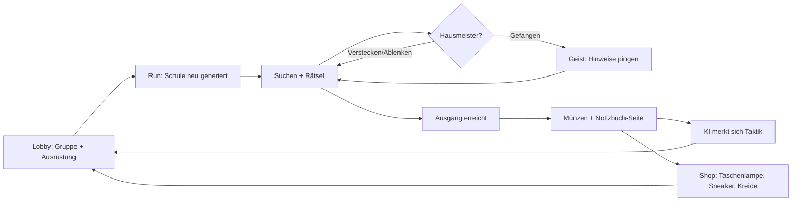

# Night Shift: Escape the Janitor – Roblox-Spielkonzept

> **Testprompt:** „Roblox Horror-Coop: 4 Freunde sind nachts in ihrer Schule eingesperrt und müssen vor dem Hausmeister-Monster fliehen, Rätsel lösen, Schlüssel finden. Zielgruppe so 11-15. Ich mach das alleine, bin aber erfahren. Mach mir nen Plan.“

> **Annahmen:** Budget ≈ 0 € für Ads · erfahrener Solo-Entwickler (Scripting + Building), Assets teils aus Creator Store/Freelancer für Monster-Modell · Ziel: Soft-Launch in ~10–12 Wochen.

---

## Reality-Check

**Was passt**
- **Koop-Horror ist eines der stärksten Roblox-Genres** – Doors (Milliarden Visits [Q: Pocket Tactics]), Piggy, The Mimic, Pressure, und 99 Nights in the Forest (14,2 Mio CCU-Peak, Koop, Wochenend-Gruppen [Q: PC Gamer 2025]). Koop-Horror zählt 2026 zu den am schnellsten wachsenden Kategorien [Q: Tracker-Zusammenfassungen Okt 2026].
- **4 Freunde = Co-Play**, ein Signal, das Roblox explizit in RFY aufgenommen hat [Q: DevForum RFY Dez 2025].
- **Jumpscares und Fluchten sind perfekte Clip-Momente** (Doors wurde über YouTuber-Reaktionen groß [Q: PCGamesN]).
- **Schule** ist für 11–15-Jährige sofort nachvollziehbar und ein Insider-Witz („meine Schule bei Nacht“).

**Was nicht passt / Risiken**
- **Genre ist extrem voll.** „Monster jagt dich durch Gebäude + Schlüssel suchen“ ist das Piggy-Grundrezept von 2020; Schul-Horror gibt es dutzendfach. Ohne eigenen Twist geht das Spiel unter.
- **Content-Verbrauch:** Eine handgebaute Schule ist nach 3–5 Runs „durchgespielt“ → D7 bricht ein. Doors löst das mit prozeduralen Räumen.
- **„4 Freunde“ als Voraussetzung:** Viele joinen allein. Ohne Matchmaking/Lobby für Solo-Spieler verliert man sie.
- **Label:** Monster-Jagd mit Jumpscares ist realistisch **Moderate** → **unsichtbar für Roblox Kids (5–8)**, sichtbar für Select (9–15) und Standard [Q: Creator Docs Content Maturity; Roblox Kids/Select April 2026]. Passt zu 11–15 – aber nicht „härter“ werden (Blut/Gewalt → Restricted wäre Reichweiten-Selbstmord).
- **Solo-Scope:** Story-Kapitel im Piggy/Mimic-Stil sind content-hungrig; das muss ein Systems-Design werden, kein Content-Design.

**Nächste existierende Spiele:** Piggy (Episoden, Escape mit Items), Doors (prozedural, Monster mit Regeln, Lobby-Shop), The Mimic (Story-Kapitel), Baldi-artige Schul-Horror-Fangames.

**Unique Hook:** *Der Hausmeister lernt: Jede Nacht merkt er sich, wie eure Gruppe ihm entkommen ist (Spinde, Lüftung, Lärm-Ablenkung) und kontert genau das in der nächsten Nacht – und die Schule baut sich jede Nacht neu zusammen.* Das erzeugt Gesprächsstoff („er hat in den Spind geschaut!!“) und Wiederspielwert ohne Handbau-Content.

**Bewertung: 6 / 10**
| Achse | Score | Begründung |
|---|---|---|
| Hook / Klickbarkeit | 6 | Schul-Horror bekannt; „lernender Hausmeister“ muss im Thumbnail sichtbar werden |
| Loop-Tiefe | 6 | Mit prozeduraler Schule + Meta-Progression ok, ohne nur 3 |
| Social / Viralität | 8 | Koop-Panik, Clips, Creator-tauglich |
| Monetarisierbarkeit | 5 | Horror-Runden monetarisieren schwächer als Simulatoren; Kosmetik + Revives |
| Machbarkeit Solo | 6 | Prozedurale Räume aus Modulen machbar; KI-Verhalten ist der aufwändigste Teil |

---

## Anpassung an Roblox
| Idee | Roblox-Version | Warum |
|---|---|---|
| Feste Schule | **Prozedurale Schule aus Raum-Modulen** (Klassenzimmer, Flur, Toilette, Turnhalle, Mensa, Bibliothek) – 30 Module, 3 Stockwerke | Wiederspielwert, Update = neue Module (wie Doors) |
| Genau 4 Freunde | **Lobby mit Aufzug/Bus für 1–4 Spieler**, Solo möglich (Hausmeister langsamer), Quick-Match füllt auf | Solo-Joiner nicht verlieren |
| Rätsel | **Kurze, visuelle Rätsel** (Farbcode an Tafel, Stundenplan-Puzzle, Sicherungskasten) – max. 30–60 Sek, ohne Lesen lösbar | Mobile + Session-Tempo |
| Eine Flucht | **„Nächte“ (Runs à 8–12 Min)**: Schlüssel/Ausweis finden → Hauptausgang; Nacht 1–5 mit steigender Schwierigkeit + Endlos-Modus | Session-Länge ~ Hit-Bereich, klare Runde |
| Hausmeister | **Adaptive KI** mit 4 Konter-Fähigkeiten, die sich nach Gruppenverhalten freischalten | Unique Hook |
| (neu) | **Meta-Progression:** Münzen → Lobby-Shop (Taschenlampen, Ausrüstung), Hausmeister-Notizbuch (Lore-Index) | D7+ |

---

## Plan

### 1. Pitch & Hook
- **Pitch:** *Night Shift ist ein Koop-Horror für 1–4 Spieler, in dem ihr nachts aus eurer Schule entkommen müsst – aber der Hausmeister lernt jede Nacht, wie ihr ihm entwischt seid, und die Schule baut sich neu.*
- **Klick-Hook:** Hausmeister-Silhouette mit leuchtenden Augen im Schulflur, Wischmopp, ein Spieler schaut aus einem Spind.
- **Erzähl-Hook:** „Er hat sich gemerkt, dass wir uns in den Spinden verstecken, und hat sie diese Nacht ALLE aufgerissen!“

### 2. Zielgruppe
| | |
|---|---|
| Kern | 11–15 (Select bis 15, danach Standard) |
| Motivation | Nervenkitzel mit Freunden, Mutprobe, gemeinsames Schreien/Lachen, Clips |
| Geräte | Mobile-first; Horror auf kleinem Display: hellere Gamma als PC-Horror, klare Silhouetten, Audio-Cues + visuelle Indikatoren (für Spieler ohne Ton!) |
| Label-Ziel | **Moderate** (Jumpscares, Bedrohung, keine Blut-Effekte) → sichtbar für Select + Standard, **nicht** Roblox Kids [Q: Creator Docs; Roblox IR April 2026] |
| Anpassungen | Kein Blut/Gore, Hausmeister „fängt“ (Bildschirm wird schwarz, Spieler landet im Hausmeisterraum als Geist) statt tötet; Kommunikation über Ping-Rad (📍 Schlüssel / ⚠️ Gefahr / 🏃 Lauf!) wegen Chat-Altersgruppen [Q: Roblox IR Jan 2026] |

### 3. Referenzspiele
| Spiel | Übernehmen | Anders |
|---|---|---|
| Doors | Prozedurale Räume, Monster mit klaren Regeln, Lobby-Shop vor Run, Revive | Ein lernender Gegner statt vieler Monster |
| Piggy | Items finden → Ausgang; Gruppenflucht; Episoden-Gefühl | Keine handgebauten Kapitel |
| 99 Nights in the Forest | „Nächte“ als Fortschrittszähler, Wochenend-Gruppen | Kürzere Runs |
| The Mimic | Lore über Fundstücke | Lore als Sammel-Index, nicht Pflicht-Story |

### 4. Core Game Loop
| Ebene | Loop |
|---|---|
| Mikro | Schleichen, Türen öffnen, Gegenstände greifen, verstecken, Ping setzen |
| Kern (1–3 Min) | Raum durchsuchen → Hinweis/Schlüsselteil → Rätsel → nächster Bereich, Hausmeister ausweichen |
| Run (8–12 Min) | 3 Schlüsselteile + Hausmeister-Ausweis → Hauptausgang; Flucht-Finale (Hausmeister verfolgt) |
| Täglich | Tägliche „Nacht-Modifikator“-Challenge (z. B. „Stromausfall“), Daily-Münzen, Notizbuch-Seiten |
| Langfristig | Nacht 1–5 → Endlos-Modus, Notizbuch 100 %, Ausrüstungs-Upgrades, Hausmeister-Varianten (Events) |

### 5. Progression & Economy
- **Währung:** 🪙 Münzen (pro Run: 20 Basis + 10/Schlüsselteil + 30 Flucht + 10/überlebender Mitspieler → fördert Teamplay). Keine zweite Währung.
- **Ausrüstung (Lobby-Shop, mit Münzen):** Taschenlampe Stufe 1–5 (Akku 60→180 Sek), Sneaker (leiser), Kreide (Wege markieren), Knallerbse (Ablenkung, Verbrauch), Pflaster (1x Fluchtversuch aus Griff). Kosten: `30 × 1,6^(Stufe−1)` → 30 / 48 / 77 / 123 / 197 Münzen (Schätzung).
- **Nächte:** Nacht 1 (Hausmeister langsam, 2 Fähigkeiten) … Nacht 5 (alle Fähigkeiten, 3 Stockwerke). Nach Nacht 5: **Endlos-Modus** mit Modifikatoren + Wochen-Leaderboard „Nächte am Stück“.
- **Adaptive KI (Kern):** Pro Gruppe/Server-Run zählt die KI Taktiken (Spinde, Lüftung, Lärm-Ablenkung, Rennen). Häufigste Taktik → nächste Nacht Konter (öffnet Spinde / versperrt Lüftungen / ignoriert erste Knallerbse / stellt Eimer-Fallen). Anzeige in der Lobby: „Der Hausmeister erinnert sich: 🔒 Spinde“ → Spieler müssen umdenken.
- **Endgame:** Notizbuch (40 Seiten Lore + Hausmeister-Geschichte), Endlos-Rekord, Hausmeister-Skins (Halloween-Hausmeister), seltene „Geheimräume“ (5 % Chance pro Run).
- **Inflationsschutz:** Verbrauchsitems als Sink; Ausrüstung maxed bei Stufe 5 → danach nur Kosmetik.

### 6. Die ersten 10 Minuten
| Zeit | Sieht | Tut | Bekommt | Freigeschaltet |
|---|---|---|---|---|
| 0:00–0:10 | Spawn im Schulbus-Lobby-Bereich, Bustür offen, Text „🚌 Einsteigen“ + Pfeil | Läuft in den Bus | – | – |
| 0:10–0:30 | Bus füllt sich (Quick-Match-Countdown 15 Sek, Solo-Button) | Wartet / drückt „Allein starten“ | Kurze Busfahrt-Cutscene (5 Sek), Licht geht aus | Run 1 = Tutorial-Nacht |
| 0:30–1:00 | Klassenzimmer, Taschenlampe leuchtet auf Tafel mit leuchtendem 🔑-Symbol | Taschenlampe an (großer Button), Tafel antippen | Erstes Schlüsselteil + Ping-Tutorial (Rad erscheint) | Ping-Rad |
| 1:00–2:00 | Schritte, Licht flackert, Wischgeräusch; Spind leuchtet | Versteckt sich im Spind (Button „🚪 Verstecken“) | Hausmeister läuft vorbei (garantiert, geskriptet) → **erster Schreck-Moment ohne Bestrafung** | Verstecken |
| 2:00–4:00 | Flur, zwei Wege, Pfützen-Spur zeigt Hausmeister-Route | Sucht zweites Teil, löst Farbcode-Rätsel (Sicherungskasten, 3 Farben) | Teil 2, Licht im Flur geht an | Rätsel |
| 4:00–6:00 | Hausmeister jagt (Musik-Wechsel, roter Bildschirmrand) | Rennt / wirft Knallerbse | Entkommt oder wird gefangen → Geist-Modus erklärt sich selbst (Geister können pingen) | Fangen/Geist |
| 6:00–8:00 | Ausweis im Hausmeisterraum | Holt Ausweis, Finale zum Haupttor | **Flucht-Finale** mit Tor-Animation | – |
| 8:00–10:00 | Lobby: „Nacht 1 überlebt! +80 🪙“, Notizbuch-Seite 1/40, Text „Der Hausmeister erinnert sich: 🔒 Spinde“ | Kauft Sneaker oder Kreide | Ziel: Nacht 2 | Shop, Notizbuch, KI-Gedächtnis |

**Session-Ende-Hook:** Lobby zeigt Nacht 2 mit Silhouette einer neuen Hausmeister-Fähigkeit („???“) + Daily-Modifikator von morgen.
**Vermieden:** Pflicht-Lesetexte, Tod in den ersten 2 Min, Kauf-Prompt vor Run-Ende, Run ohne Solo-Option.

### 7. Retention-Systeme
| Fenster | Mechanik | Ausgestaltung | Referenz |
|---|---|---|---|
| D1 | Nacht-Fortschritt | „Nacht 2 freigeschaltet“ + Teaser neue Fähigkeit | 99 Nights (Nächte-Zähler) |
| D1 | Daily-Modifikator | Täglich wechselnde Regel (Stromausfall, Rollschuh-Hausmeister, Nebel) + Bonusmünzen | Doors-Modifikatoren |
| D1 | KI-Gedächtnis | Gruppe will testen, ob er wirklich kontert | Unique Hook |
| D2–7 | Notizbuch-Seiten | 40 Seiten, Belohnung bei 10/20/30/40 (Taschenlampen-Skins) | The Mimic Lore |
| D2–7 | Wochen-Leaderboard Endlos | Reset montags | |
| D2–7 | Freitag-Nacht-Event | Freitag 20:00–So: „Vollmond-Nacht“ 2x Münzen + Geheimraum-Chance ↑ | 99 Nights Wochenend-Peaks [Q: PC Gamer] |
| D8–30 | Neue Raum-Module alle 2 Wochen | Chemielabor, Schwimmhalle, Dach | Doors Updates |
| D8–30 | Hausmeister-Varianten | Halloween-Hausmeister, „Direktorin“ als Zweitgegner (Woche 6+) | |
| D8–30 | Experience Notifications (13+) | „Der Hausmeister hat eine neue Fähigkeit 👀“ zu Updates | [Q: Creator Docs] |

### 8. Social & Viralität
- **Interaktion:** Rollen ergeben sich (Läufer, Rätsler, Ablenker); Revive durch Mitspieler (Geist befreien am Schließfach); Ping-Rad statt Chat.
- **Einladen:** In der Lobby „Freund in den Bus holen“ (`PromptGameInvite`). Belohnung: gemeinsame Flucht mit eingeladenem Freund → beide „Klassenfahrt“-Rucksack-Skin.
- **Trading:** nein (kein Bedarf, spart Anti-Dupe-Aufwand).
- **Clip-Momente:**
  1. **Der Konter** – Hausmeister reißt genau den Spind auf, in dem jemand sitzt (KI-Gedächtnis) → Schrei-Reaktion.
  2. **Last-Second-Flucht** – Tor schließt sich, letzter Spieler rutscht durch (Slide-Animation).
  3. **Geist-Trolling** – Geister pingen falsche Wege (Spaß unter Freunden).
  4. **Geheimraum** (5 %) – „Hausmeisters Trophäenraum“ mit Fotos der Spieler aus vorherigen Nächten (Screenshots der Fangmomente!).
- **Creator-Tauglichkeit:** Modifikator-Challenges („Nur mit Knallerbsen“), Custom-Lobby für Creator mit selbstgewählten Modifikatoren (Private Server), Codes für Taschenlampen-Skins.

### 9. Monetarisierung
| Produkt | Typ | Preis | Nutzen | Begründung | Wann |
|---|---|---|---|---|---|
| Wiederbelebung | Dev Product | 49 R$ | 1x pro Run sofort aus Geist-Modus zurück | Doors-Prinzip; begrenzt, damit Schwierigkeit erhalten bleibt; Gratis-Alternative: Mitspieler befreit dich am Schließfach | **Nur passiv:** kleiner Button im Geist-Screen, kein Popup, kein Countdown, nicht in Run 1 (Abwägung siehe `monetization.md`: Kauf nach Misserfolg = Verlustangst-Muster) |
| Taschenlampen-Skins | Game Pass | je 79–99 R$ | Kosmetik (Farbe, Lichtkegel-Form, kein Reichweiten-Bonus) | Status, sichtbar für Mitspieler | Lobby-Shop |
| Lobby-Emotes-Pack | Game Pass | 99 R$ | 6 Emotes (Panik, Tanz, Hausmeister-Imitation) | Social, Clips | Lobby |
| VIP-Hall-Pass | Game Pass | 299 R$ | +25 % Münzen, VIP-Busplatz (Lobby-Kosmetik), goldener Rucksack, Chat-Tag | Bündel; +25 % = Zeitersparnis, kein Run-Vorteil | Shop |
| Starter-Rucksack | Dev Product (1x) | 79 R$ | 300 🪙 + 3 Knallerbsen + Rucksack-Skin | Erstkauf | Nach erster erfolgreicher Flucht |
| Münzpakete | Dev Product | 49 / 129 / 299 R$ | 150 / 450 / 1.100 🪙 | Abkürzung für Ausrüstung | Shop |
| Private Server | Roblox | 100 R$/Monat | Eigene Gruppe + Custom-Modifikatoren | Creator/Freundesgruppen | Spielseite |
| Hausmeister-Skin-Pack (Events) | Game Pass | 149 R$ | Server-Gastgeber wählt Hausmeister-Look (z. B. Kürbis) | Kosmetik für alle sichtbar | Events |

- **Creator Rewards:** Sessions ≥ 10 Min sind bei Run-Länge realistisch → zählt für Daily Engagement Rewards [Q: DevForum Creator Rewards 2025].
- **Rewarded Ads:** möglich für 13+: „Video → +1 Knallerbse vor dem Run“, max. 1x/Run; Altersgrenzen im Creator Hub prüfen.
- **Bewusst NICHT verkauft:** Zufalls-Kisten (Skins nur direkt), Fähigkeiten, die den Hausmeister schwächen, bessere Taschenlampen-Reichweite gegen Robux, Nacht-Skips, mehrfache Revives pro Run.
- **Richtlinien:** Preise in R$ sichtbar, Event-Countdowns echt, kein „Revive-Countdown“ unter Zeitdruck (Spieler kann in Ruhe ablehnen). Da ein Teil der Zielgruppe unter 13 ist: Mitspieler-Revive ist der Hauptweg, der Kauf-Revive nur Komfort.

### 10. LiveOps & Update-Plan
**Launch:** 3 Stockwerke, 30 Raum-Module, Hausmeister mit 4 Konter-Fähigkeiten, Nacht 1–5, Endlos-Modus, 6 Modifikatoren, 20 Notizbuch-Seiten.
| Woche | Update | Ziel |
|---|---|---|
| 1 | Balance (Hausmeister-Tempo Solo vs. 4er) aus Fang-Statistik | Bounce, D1 |
| 2 | 5 neue Module (Chemielabor) + 2 Modifikatoren | D2–7 |
| 3 | Freitag-Vollmond-Event fest etabliert | Wochenend-Peaks |
| 4 | Notizbuch 21–40 + Geheimraum-Varianten | D8–28 |
| 5–6 | Halloween: Kürbis-Hausmeister, Kostüm-Skins, Event-Nacht | Rückkehrer |
| 7 | Zweitgegnerin „Direktorin“ (patrouilliert, ruft Hausmeister) | Tiefe |
| 8 | Ranked-Endlos-Saison 1 | D30 |
**Update-Tag:** Freitag 18:00 MEZ (vor Wochenend-Peak).

### 11. Icon, Thumbnail, Titel
- **Titel:** 1) **Night Shift: Escape the Janitor** (Favorit – Handlung + Gegner im Titel) · 2) Escape the Night School · 3) Janitor's Revenge
- **Icon:** Hausmeister-Gesicht halb im Schatten, gelbe leuchtende Augen, Schlüsselbund im Mund-Bereich; dunkelblau/gelb, hoher Kontrast.
- **Thumbnails:** (a) Spieler im Spind, Hausmeister-Hand an der Tür · (b) 4 Spieler rennen durch Flur, Hausmeister hinten mit Mopp · (c) Lobby-Text „ER ERINNERT SICH…“ mit Spind-Symbol · (d) Geheimraum mit Spielerfotos.
- **Beschreibung:** „🌙 Entkommt mit bis zu 4 Freunden aus der Schule! • 🧠 Der Hausmeister LERNT eure Tricks • 🏫 Jede Nacht neue Räume • 🔦 Ausrüstung & Notizbuch-Geheimnisse • 🎃 Freitag-Nacht-Events“

### 12. KPI-Ziele
| KPI | Benchmark | Soft-Launch | Launch | Wenn schlechter → |
|---|---|---|---|---|
| D1 | Median 10,3 % [Q: GameAnalytics 2026] | ≥ 10 % | ≥ 15 % | Nacht-2-Teaser stärker, Daily-Modifikator früher zeigen |
| D7 | Median 1,6 % [Q: ebd.] | ≥ 2 % | ≥ 3,5 % | Mehr Module, KI-Konter sichtbarer |
| Session | 19+ Min = Hit-Bereich [Q: GameAnalytics 2025] | ≥ 15 Min (≈ 2 Runs) | ≥ 20 Min | Lobby-Wartezeit ↓, Run-Ende → sofort „Nochmal“ |
| Run-Abschlussrate Nacht 1 | eigene Messung | 60–75 % | – | > 85 % zu leicht, < 50 % zu schwer |
| Gruppen-Anteil (≥ 2 Spieler) | eigene Messung | ≥ 50 % der Runs | ≥ 60 % | Quick-Match-Auffüllung, Invite-Belohnung |
| Payer-Conversion 30 T | 3,8 %/Jahr [Q: GameAnalytics 2026] | ≥ 1 % | ≥ 2 % | Starter-Rucksack-Timing, Skins sichtbarer |
Alle Ziele = Schätzung.

### 13. Technische Umsetzung
- **Places:** Lobby-Place + Run-Place; Gruppen via `TeleportService:ReserveServer`; Quick-Match über `MemoryStoreService`-Queue.
- **Module:** LobbyService, MatchmakingService, SchoolGenerator (Graph aus Raum-Modulen mit Tür-Sockeln, Seed pro Run, garantierte Erreichbarkeit aller Schlüsselteile), JanitorAI (State Machine: Patrouille → Hören → Suchen → Jagen; `PathfindingService` mit Pfad-Cache; Taktik-Zähler → Konter-Flags), PuzzleService, RunService (Ziele, Fang, Geist, Revive, ProcessReceipt), DataService (ProfileStore), AnalyticsService.
- **DataStore:** `{ version, coins, gear = {flashlight=2, sneakers=1}, consumables = {firecracker=3}, nightsUnlocked=2, endlessBest=0, notebook = {[1]=true}, cosmetics = {}, janitorMemory = nil (pro Run-Gruppe, nicht pro Spieler), daily = {...}, receipts = {} }`
- **Mobile:** Licht über wenige `SpotLight`s (Taschenlampe) + Baked-Look durch Material/Farben statt vieler Lichter; Module klein, Streaming an; Gamma-Option; Haptik bei Jagd.
- **Anti-Exploit:** Hausmeister komplett serverseitig; Item-Pickup über Server-Distanzcheck; Rätsel-Lösung serverseitig validiert; Speed-Check; Revive-Kauf nur im Geist-Zustand gültig.
- **Server-Größe:** Lobby 24, Run 4.

### 14. Roadmap
| Phase | Inhalt | Dauer (Schätzung, Solo erfahren) |
|---|---|---|
| MVP | Generator mit 15 Modulen, Hausmeister-KI mit 2 Kontern, Nacht 1–3, Ping, Geist, Lobby, Shop, Daten | 6–7 Wochen |
| Soft Launch | + 15 Module, Nacht 4–5, Endlos, Revive, 3 Passes; **Gate:** D1 ≥ 10 %, Run-Abschluss Nacht 1 60–75 % | Woche 8–10 |
| Launch | Notizbuch, Daily-Modifikatoren, Freitag-Event, Creator-Outreach (15 Horror-YouTuber) | Woche 11–12 |

| Must | Should | Could | Won't |
|---|---|---|---|
| Generator (L), Hausmeister-KI (L), Lobby/Matchmaking (M), Rätsel ×4 (M), Geist/Revive (S), Shop+Daten (M), Mobile-Steuerung (M) | Konter-System 4 Fähigkeiten (M), Notizbuch (S), Modifikatoren (S), Passes (S) | Endlos-Leaderboard (S), Direktorin (M), Geheimräume (S) | Voice-Pflicht, Story-Cutscenes, Trading, offene Welt |

### 15. Risiken & Unsicherheiten
| Risiko | W. | Auswirkung | Gegenmaßnahme |
|---|---|---|---|
| KI-Konter wird von Spielern nicht bemerkt | mittel | Hook verpufft | Lobby-Anzeige + dramatischer Konter-Moment (Kamera-Fokus) |
| Prozedurale Schule wirkt beliebig | mittel | Weniger Atmosphäre | Handgebaute „Anker-Räume“ (Eingangshalle, Hausmeisterraum) fix |
| Solo-Runs zu schwer/leicht | hoch | Bounce | Dynamische Schwierigkeit nach Spielerzahl, Fang-Telemetrie |
| Genre-Sättigung | hoch | Niedrige PTR | Thumbnail testet Hook „ER ERINNERT SICH“ gegen generische Motive |
| Label rutscht in Restricted | niedrig | Reichweite weg | Kein Blut, „Fangen“ statt Töten, Fragebogen ehrlich |
| Pathfinding-Performance mit vielen Servern | mittel | Lags | Pfad-Cache, Wegpunkt-Graph statt Voll-Pathfinding |

**Größte offene Annahme:** Dass der lernende Hausmeister für Spieler *spürbar und lustig* ist, nicht unfair. → Als Erstes einen Graybox-Run mit 2 Kontern bauen und 3–4 Gruppen spielen lassen; messen, ob sie den Konter ansprechen („er weiß es!“).
