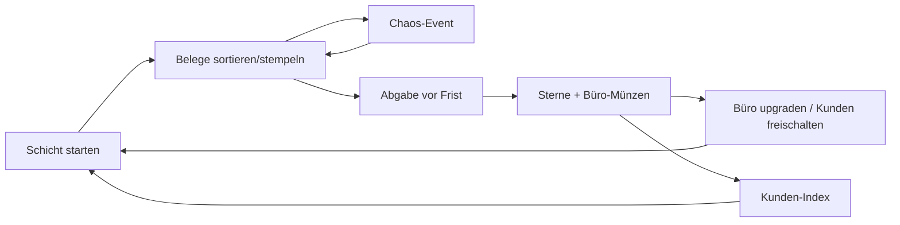

# Buchhaltungs-Simulator → Pivot „Paper Panic“ – Roblox-Spielkonzept

> **Testprompt:** „Mein Spielkonzept für Roblox: ein realistischer Buchhaltungs-Simulator. Man spielt einen Steuerberater, liest Belege und füllt Steuererklärungen für Firmen aus. Singleplayer, sehr textlastig, soll lehrreich sein. Wie mache ich daraus einen Hit?“

> **Annahmen:** Teamgröße/Erfahrung unbekannt → angenommen 1–2 Personen mit Grundkenntnissen; Budget ≈ 0 €. Das Lernziel ist dir wichtig, aber „Hit“ ist das genannte Ziel – deshalb priorisiere ich Spielspaß und zeige, wo Lernen erhalten bleibt.

---

## Reality-Check

Ehrlich vorweg: **In der beschriebenen Form wird das auf Roblox kein Hit.** Nicht weil das Thema verboten wäre, sondern weil fast jede Eigenschaft gegen das arbeitet, was die Plattform belohnt.

**Was nicht passt**
| Eigenschaft | Problem auf Roblox | Beleg |
|---|---|---|
| Sehr textlastig | ~35 % der altersgeprüften Nutzer sind unter 13, 38 % 13–17 [Q: Roblox Q2 2026 Shareholder Letter]; viele Jüngere lesen langsam, und ~80 % der Aktivität ist mobil [Q: pocketgamer.biz 2025] – Formulare auf dem Handy sind mühsam | `audiences.md` |
| Realistisch / Steuererklärungen | Kein Klickgrund im Feed; „Hausaufgaben-Gefühl“. Die Hits 2025–26 versprechen eine Fantasie in 3 Wörtern (Grow a Garden, Steal a Brainrot) | `virality-social.md` |
| Singleplayer | Kein Co-Play-Signal (seit Dez 2025 im RFY-Algorithmus [Q: DevForum RFY]), kaum Clip-Momente, keine Freundes-Einladungen | `platform-algorithm.md` |
| Lehrreich als Hauptziel | Lerninhalte sind für Roblox-Spieler kein Klickgrund; funktioniert nur eingebettet („Stealth Learning“) | `genre-playbooks.md` |
| Lesen + Ausfüllen = langsamer Einstieg | First Play Bounce Rate ist seit 2026 eines der wichtigsten Ranking-Signale [Q: Creator Docs Discovery] – ein Formular in Minute 1 treibt sie hoch | `onboarding-ftue.md` |

**Was passt (der verwertbare Kern)**
- **Sortieren, Stempeln, Prüfen** sind befriedigende, schnelle Mikro-Aktionen (Papers, Please hat das außerhalb Roblox bewiesen – dort aber für Erwachsene am PC).
- **„Büro-Chaos“** ist als Koop-Comedy-Format sehr Roblox-tauglich (Rollenspiele mit Jobs wie in Brookhaven/Work-at-a-Pizza-Place-artigen Spielen; Overcooked-artiges Zeitdruck-Koop).
- **Eine eigene Firma aufbauen** ist ein klassischer Tycoon-Loop.

**Nächste existierende Spiele:** Job-Simulatoren/Tycoons (Office/Bank-Tycoons), Koop-Chaos-Kochspiele auf Roblox, „Papers, Please“ (Steam) als Mechanik-Vorbild.

**Unique Hook der Originalidee:** keiner, der im Feed funktioniert.

**Bewertung: 2 / 10**
| Achse | Score | Begründung |
|---|---|---|
| Hook / Klickbarkeit | 1 | „Steuererklärung“ ist für die Zielgruppe ein Anti-Hook |
| Loop-Tiefe | 3 | Realistische Buchhaltung hat Tiefe, aber keinen Belohnungs-Takt |
| Social / Viralität | 1 | Singleplayer, Text, keine Clip-Momente |
| Monetarisierbarkeit | 2 | Kaum Kaufanlässe ohne Spielspaß-Loop |
| Machbarkeit | 6 | Technisch einfach – das ist nicht das Problem |

### Pivot-Vorschläge
| Pivot | Idee | Referenz | Was vom Kern bleibt | Fit |
|---|---|---|---|---|
| **A) Paper Panic (Koop-Chaos)** | 1–4 Spieler arbeiten im völlig überforderten Steuerbüro: Belege fliegen rein, müssen nach Symbol/Farbe sortiert, gestempelt, geprüft werden – unter Zeitdruck, mit Chaos-Events (Ventilator, Kaffee verschüttet, Chef-Inspektion). Zwischen Schichten Büro upgraden. | Overcooked-artige Koop-Spiele, Job-Roleplays, Tycoon-Meta | Belege prüfen, Fehler finden, Firmen als „Kunden“, Grundbegriffe (Einnahme/Ausgabe, Quittung, Frist) als Symbole | **6/10** |
| B) Tax Office Tycoon | Idle-Tycoon: eigenes Steuerbüro aufbauen, NPC-Angestellte bearbeiten Akten automatisch, Spieler macht Mini-Prüfungen für Boni | Klassische Tycoons, Grow-a-Garden-Timer | Firmen-/Büro-Fantasie, einfache Wirtschaftslogik | 5/10 |
| C) Lernspiel außerhalb von Discovery | Wenn das Lernziel wirklich Priorität hat: als Unterrichtsspiel für Schulen/Lehrkräfte bauen (gezielte Verteilung statt Algorithmus), oder andere Plattform | – | Alles (realistisch, textlastig) | Für „Hit“ ungeeignet, für Bildung sinnvoll |

**Empfehlung:** Pivot **A „Paper Panic“** mit der Tycoon-Meta aus B. Er erhält den Kern (Belege prüfen, Fehler finden) und dreht ihn in das, was Roblox belohnt: Koop, Chaos, kurze Runden, Clips. Der folgende Plan beschreibt **diesen Pivot**, nicht die Originalidee.

---

## Anpassung an Roblox
| Original | Pivot-Version | Warum |
|---|---|---|
| Belege lesen | Belege mit **Symbolen/Farben/Zahlen ≤ 3 Stellen** (🍕 12 € rot = Ausgabe) | Lesbar ohne Text, mobil, für 9-Jährige |
| Steuererklärung ausfüllen | **Sortieren + Stempeln + Fehler-Finden** (Beleg passt nicht zur Rechnung → roter Stempel) | Schnelle Mikro-Aktionen |
| Singleplayer | **1–4 Spieler Koop-Schichten** (Solo möglich, kleineres Büro) | Co-Play, Clips |
| Realistisch | **Comedy-Chaos** (Ventilator, Hund des Chefs frisst Belege) | Clip-Momente, Zielgruppe |
| Lehrreich | **Stealth Learning**: Einnahme/Ausgabe, Summen bis 100, Fristen – als Spielregeln, Glossar optional | Lernen bleibt, aber nicht als Hürde |
| Ein Job | **Meta: Büro upgraden, Kunden-Firmen sammeln** (vom Limonadenstand bis zur Raketenfirma) | Langzeit-Loop |

---

## Plan (Pivot „Paper Panic“)

### 1. Pitch & Hook
- **Pitch:** *Paper Panic ist ein Koop-Chaos-Spiel für 1–4 Spieler, in dem ihr im überforderten Steuerbüro Belege sortiert, stempelt und Betrügern auf die Schliche kommt – bevor der Papierberg das Büro begräbt.*
- **Klick-Hook:** Spieler versinken bis zum Hals in einem Papier-Tornado, einer hält triumphierend einen Stempel hoch.
- **Erzähl-Hook:** „Wir haben die Raketenfirma geschafft, obwohl der Hund die Hälfte gefressen hat!“

### 2. Zielgruppe
| | |
|---|---|
| Kern | 9–13 |
| Motivation | Chaos mit Freunden, Zeitdruck-Spaß, Büro freischalten, lustige Firmen |
| Geräte | Mobile-first: Tap-Drag auf Ablage-Körbe, große Stempel-Buttons |
| Label | **Minimal** → sichtbar inkl. Roblox Kids [Q: Creator Docs] |
| Anpassungen | Zahlen max. 2–3-stellig, Symbole statt Text, kein Verlieren-Frust (Schicht endet mit Sternen 1–3, nie „Game Over“-Bildschirm) |

### 3. Referenzspiele
| Spiel | Übernehmen | Anders |
|---|---|---|
| Overcooked-artige Koop-Spiele | Zeitdruck-Koop, Stationen, Chaos | Papier statt Essen, Prüf-Mechanik |
| Papers, Please (Steam) | Prüfen auf Unstimmigkeiten | Kindgerecht, Comedy, Koop |
| Dress to Impress | Kurze Runden mit Bewertung | Sterne vom „Chef“ statt Spieler |
| Klassische Tycoons | Büro wächst zwischen Schichten | Meta statt Hauptloop |

### 4. Core Game Loop
| Ebene | Loop |
|---|---|
| Mikro | Beleg greifen → richtigen Korb (Einnahme/Ausgabe/Verdächtig) → Stempel-Sound |
| Kern (Schicht 4–6 Min) | Kunden-Firma bringt Stapel → sortieren, Summe prüfen, Fehler finden → Abgabe vor Frist → 1–3 Sterne |
| Session | 3–4 Schichten → neue Kunden-Firma freischalten → Büro-Upgrade |
| Täglich | „Kunde des Tages“ (Spezialregeln), Daily-Bonus, Restock im Büro-Shop |
| Langfristig | 30 Kunden-Firmen (Index), Büro-Etagen, Event-Kunden (Weihnachtsmann-GmbH), Wochen-Rangliste |

### 5. Progression & Economy
- **Währung:** 📎 Büroklammern (Soft) – pro Schicht `20 + 15 × Sterne + 5 × gefundene Fehler`.
- **Upgrades (Büro):** Größere Körbe, Rohrpost (Beleg-Teleport), Kaffeemaschine (Laufen +10 %), Aktenvernichter (Sink für falsche Belege). Kosten `40 × 1,35^(Stufe−1)`: 40 / 54 / 73 / 98 / 133 … (Schätzung).
- **Kunden-Firmen:** 30 Stück in 5 Stufen (Limonadenstand → Raketenfirma); Freischaltung per Sternen (3 / 8 / 15 / 25 / 40 Sterne).
- **Prestige:** „Büro-Franchise“ nach Kunde 30: Büro neu in anderer Stadt, +25 % Klammern permanent.
- **Inflationsschutz:** Upgrades gedeckelt (Stufe 10), danach Kosmetik (Büro-Deko).

### 6. Die ersten 10 Minuten
| Zeit | Sieht | Tut | Bekommt | Freigeschaltet |
|---|---|---|---|---|
| 0:00–0:10 | Büro, ein Beleg schwebt leuchtend über dem Tisch, zwei Körbe 🟢/🔴 blinken | Tippt Beleg, zieht ihn in 🟢 | „STEMPEL!“-Sound, +2 📎 | Sortieren |
| 0:10–0:40 | 5 weitere Belege (Symbol = Farbe des Korbs) | Sortiert | Fortschrittsbalken „Limonadenstand 6/6“ | – |
| 0:40–1:30 | Ein Beleg wackelt (🍋 ×10 = 50?), Lupe-Button pulsiert | Lupe → erkennt falsche Summe → 🔍-Korb | Konfetti, „Betrug entdeckt! +10 📎“ | Fehler-Finden |
| 1:30–4:00 | Erste echte Schicht (3 Min), Uhr läuft gemütlich | Sortiert ~20 Belege, Ventilator-Chaos-Event | 2–3 Sterne | Schicht |
| 4:00–6:00 | Büro-Shop mit 3 Upgrades | Kauft Kaffeemaschine | Schneller | Upgrades |
| 6:00–9:00 | Zweite Schicht mit Kunde „Pizza-Express“ + Bus mit Quick-Match | Spielt (ggf. mit anderen) | Sterne, neuer Kunde | Koop/Quick-Match |
| 9:00–10:00 | Kunden-Index 2/30, morgen: „Kunde des Tages: Zirkus 🎪“ | – | Ziel | Daily |

### 7. Retention-Systeme
| Fenster | Mechanik | Ausgestaltung |
|---|---|---|
| D1 | Kunde des Tages | Spezialregel (Zirkus: Belege springen weg) + 2x Klammern |
| D1 | Daily-Kalender | 7 Tage, Tag 7 = Büro-Haustier (Katze schubst Belege – Chaos-Kosmetik) |
| D2–7 | Kunden-Index | Belohnung bei 10/20/30 |
| D2–7 | Wochen-Highscore pro Kunde | Reset montags |
| D8–30 | Event-Kunden | Halloween: Geister-GmbH (Belege unsichtbar ohne Taschenlampe) |
| D8–30 | Franchise-Prestige | Neue Stadt, neue Chaos-Events |

### 8. Social & Viralität
- Koop-Rollen entstehen (Sortierer, Prüfer, Läufer); Quick-Match füllt auf; Invite-Belohnung: gemeinsamer Bürohund-Skin.
- **Clip-Momente:** Papier-Tornado begräbt alle (Ragdoll im Papierberg) · Chef-Inspektion in letzter Sekunde bestanden · absurde Betrugsbelege („Einhorn-Futter 9.999 €“).
- Creator: Challenge „Nur 1 Hand“ (nur Linkklick), Speedrun-Rangliste.

### 9. Monetarisierung
| Produkt | Typ | Preis | Nutzen | Begründung |
|---|---|---|---|---|
| Starter-Büro | Dev Product (1x) | 79 R$ | 200 📎 + Neon-Stempel | Erstkauf nach erster 3-Sterne-Schicht |
| 2x Büroklammern | Game Pass | 199 R$ | Doppelte Klammern | Zeitersparnis, kein Schicht-Vorteil |
| Stempel-Skins | Game Pass | je 49–79 R$ | Kosmetik + Stempel-Sound | Impulskauf, sichtbar für Team |
| VIP-Chef-Büro | Game Pass | 299 R$ | Chef-Sessel-Lobby, Krawatte, +1 Daily-Kiste (fester Inhalt), Tag | Status |
| Büro-Deko-Pakete | Game Pass | 99 R$ | Pflanzen, Poster, Aquarium | Kosmetik |
| Server-Kaffeerunde | Dev Product | 39 R$ | +20 % Tempo für alle 1 Schicht | Sozial positiv |
- **Bewusst NICHT verkauft:** Schicht-Siege/Sterne, Zufallskisten, Zeitverlängerung in der Schicht gegen Robux (Druckmoment!), Kunden-Freischaltung gegen Robux.
- Creator Rewards: Sessions 3–4 Schichten ≈ 15–20 Min → qualifiziert für Daily Engagement bei Active Spendern [Q: DevForum Creator Rewards].

### 10. LiveOps & Update-Plan
**Launch-Inhalt:** 12 Kunden (Stufe 1–3), 4 Chaos-Events (Ventilator, Kaffee, Chef-Inspektion, Stromausfall), 8 Upgrades, Quick-Match.
| Woche | Update | Ziel-KPI |
|---|---|---|
| 1 | Tutorial-Belege nach Funnel-Daten vereinfachen | Funnel „erste Schicht beendet“ |
| 2 | +4 Kunden (Zoo, Feuerwehr, Eisdiele, Arcade) | D2–7 |
| 3 | „Kunde des Tages“ mit Spezialregeln | D1 |
| 4 | Wochen-Highscores pro Kunde + Stempel-Skins | D7, Conversion |
| 5–6 | Halloween: Geister-GmbH (Belege unsichtbar ohne Taschenlampe), Event-Deko | Rückkehrer |
| 7 | Franchise-Prestige (neue Stadt, +25 % Klammern) | D8–28 |
| 8 | +6 Kunden bis Raketenfirma, Bürohund-Live-Event | D30, Clips |

**Event-Ideen:** Steuer-Deadline-Panik (Wochenende, doppelte Belege, doppelte Sterne) · Bürohund-Tag (Hund stiehlt Belege, Team muss ihn fangen) · Weihnachtsmann-GmbH (Wunschzettel als Belege).
**Update-Tag:** Samstag 17:00 MEZ, Countdown im Spiel.

### 11. Icon, Thumbnail, Titel
- **Titel:** 1) **Paper Panic 📄** (Favorit – Alliteration, Chaos-Versprechen) · 2) Stamp It! Office Chaos · 3) Tax Office Tycoon (wenn Pivot B)
- **Icon:** Panisches Avatar-Gesicht hinter Papierwirbel, roter STEMPEL-Abdruck „OK!“.
- **Thumbnails:** (a) Papier-Tornado · (b) 4 Spieler mit Stempeln, Chef mit Stoppuhr · (c) absurder Beleg „Einhorn-Futter“ mit Lupe · (d) Raketenfirma-Kunde mit Rakete im Büro.

### 12. KPI-Ziele
| KPI | Benchmark | Soft-Launch | Wenn schlechter → |
|---|---|---|---|
| D1 | Median 10,3 % [Q: GameAnalytics 2026] | ≥ 8 % (Nischen-Hook, vorsichtig) | Kunde des Tages früher zeigen |
| D7 | Median 1,6 % | ≥ 1,5 % | Mehr Kunden/Chaos-Events |
| Session | Median ~7–10 Min | ≥ 12 Min | Schicht-Übergang beschleunigen |
| Funnel: erste Schicht beendet | eigene Messung | ≥ 80 % | Tutorial-Belege vereinfachen |
| Koop-Anteil | eigene Messung | ≥ 40 % | Quick-Match sichtbarer |
Alle Ziele = Schätzung.

### 13. Technische Umsetzung
- Lobby + Schicht-Server (reserviert, 1–4 Spieler); BelegGenerator (Kunden-Config → Belege mit Symbol, Betrag, Fehler-Flag; Zahlen kindgerecht), ShiftService (Timer, Sterne serverseitig), ChaosEventService, UpgradeService, DataService (ProfileStore).
- DataStore: `{ version, clips, upgrades = {}, customers = {[id] = {stars = 3}}, index = {}, cosmetics = {}, daily = {}, receipts = {} }`
- Mobile: Drag & Drop mit großzügigen Drop-Zonen; Papier-Physik nur visuell (Client-seitig), Belege serverseitig als Daten.
- Anti-Exploit: Sortier-Aktion validiert gegen Server-Belegliste + Rate-Limit; Sterne nur vom Server.

### 14. Roadmap
| Phase | Inhalt | Dauer (Schätzung, 1–2 Personen) |
|---|---|---|
| Graybox-Test | 1 Schicht, 2 Kunden, Sortieren + Lupe, 1 Chaos-Event – mit 3 Gruppen testen | 1–2 Wochen |
| MVP | 1 Büro, 6 Kunden, 2 Chaos-Events, Koop-Lobby, Upgrades, ProfileStore | 4–6 Wochen |
| Soft Launch | **Gate:** D1 ≥ 8 %, Funnel ≥ 80 %, Koop-Anteil ≥ 40 % | 2 Wochen |
| Launch | 12 Kunden, Passes, Daily, tägliche TikTok-Clips, 10–20 Creator anschreiben | Woche 9–10 |

| Must | Should | Could | Won't (jetzt) |
|---|---|---|---|
| Beleg-Generator + Sortieren (M), Koop-Schicht (M), Chaos-Events (S), Upgrades (S), Mobile-Drag (M), Daten (M) | Kunden-Index (S), Daily/Kunde des Tages (S), Passes (S), Quick-Match (M) | Franchise-Prestige (M), Highscores (S), Profi-Modus für Schulen (M) | Echte Formulare, Text-Glossar als Pflicht, Singleplayer-Story |

### 15. Risiken & Unsicherheiten
| Risiko | Gegenmaßnahme |
|---|---|
| „Büro/Steuern“ bleibt trotz Chaos ein Anti-Hook | Titel/Thumbnail ohne „Steuer“; Chaos in den Vordergrund |
| Koop-Chaos-Genre auf Roblox kleiner als Simulatoren | Tycoon-Meta stärkt Solo-Retention |
| Lernziel geht verloren | Optionaler „Profi-Modus“ mit echten Begriffen für Ältere/Schulen |

**Größte offene Annahme:** Dass Sortieren + Prüfen mit Chaos-Events in Koop *lustig* ist. → Graybox-Schicht mit 2 Kunden bauen, mit 3 Gruppen testen, bevor Meta-Systeme entstehen.
