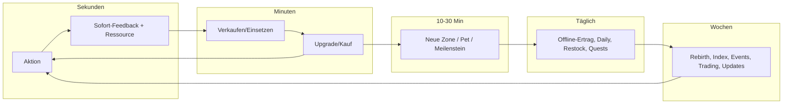

# Core Loops & Economy auf Roblox

Kennzeichnung: **[Q: …]** belegt, **[Erfahrungswert]/[Schätzung]** = Designpraxis. Die Loop-Muster selbst sind Beschreibungen öffentlich spielbarer Spiele.

## Inhalt
1. Loop-Ebenen (Sekunden → Wochen)
2. Bewährte Loop-Muster (10 Typen)
3. Economy-Design: Währungen, Kurven, Rebirth, Inflation
4. Diagramm-Vorlage
5. Anti-Patterns

---

## 1. Loop-Ebenen
Ein Roblox-Hit hat auf **jeder** Ebene einen klaren Grund weiterzuspielen:

| Ebene | Zeitraum | Frage, die der Spieler sich stellt | Beispiel (Grow a Garden) |
|---|---|---|---|
| Mikro | 1–10 Sek | „Was mache ich jetzt?“ | Samen pflanzen, ernten, Zahl fliegt hoch |
| Kern | 1–5 Min | „Wofür?“ | Ernte verkaufen → neuen/besseren Samen kaufen |
| Session | 10–30 Min | „Was erreiche ich heute?“ | Seltenen Samen im Restock erwischen, Garten erweitern |
| Täglich | 1 Tag | „Warum morgen wieder?“ | Pflanzen wachsen offline weiter, Shop-Restock, Wetter-Events |
| Langfristig | Wochen | „Was ist mein großes Ziel?“ | Mutationen sammeln, seltene Pets, wöchentliche Updates, Trading |

Ein Plan muss jede Zeile ausfüllen. Wenn „Langfristig“ leer bleibt, wird D8–28-Retention (jetzt Teil des RFY-Algorithmus, siehe `platform-algorithm.md`) schwach.

## 2. Loop-Muster

### A) Collect → Upgrade → Rebirth (Simulator)
`Klicken/Sammeln → Währung → Upgrade (mehr pro Klick / mehr Kapazität) → neue Zone → … → Rebirth (Reset gegen permanenten Multiplikator)`
- Referenzen: Pet Simulator 99, klassische „X Simulator“-Spiele.
- Stärke: Sofort verständlich, „Number go up“, lange Progression via Rebirth.
- Schwäche: Austauschbar; braucht starkes Thema/Pets/Sammel-Meta. Rein klickbasiert = Session < 10 Min **[Erfahrungswert]**.
- Pflicht-Zusatz: Pets/Sammel-Index als zweiter Layer, Zonen-Gates, Events.

### B) Tycoon
`Dropper/Produktion → Geld sammeln → Buttons kaufen (Gebäude wächst) → mehr Einkommen → Tycoon fertig → Rebirth/neues Theme`
- Referenzen: Klassische Tycoons; **Steal a Brainrot** als Tycoon + PvP-Diebstahl (Charaktere im Base erzeugen Geld, können aus ungeschützten Basen gestohlen werden) **[Q: Wikipedia „Steal a Brainrot“, 2025]**.
- Stärke: Sichtbarer Fortschritt (die Basis *wächst*) → stark für Screenshots/Clips.
- Schwäche: Klassischer Tycoon ist nach 30–60 Min „fertig“ → braucht Rebirth, Anpassbarkeit oder Social-Twist.

### C) Grow/Idle mit Timern
`Pflanzen/Brüten → Warten (auch offline) → Ernten → Verkaufen → Bessere Samen (Shop-Restock alle X Min)`
- Referenz: **Grow a Garden** – Seed-Shop restockt ca. alle 5 Min **[Q: deltiasgaming / pcgamesn Grow-a-Garden-Guides, 2025]**, Wetter-Events wirken serverweit auf alle Gärten **[Q: Sportskeeda Weather Guide, 2025]**.
- Stärke: Mehrere kurze Sessions am Tag (passt zu ~3 Roblox-Opens/Tag, siehe Benchmarks), entspannte Zielgruppe, Offline-Fortschritt = D1-Treiber.
- Schwäche: Kann ohne Social/Trading-Layer flach werden.

### D) Obby / Parkour
`Checkpoint erreichen → nächste Stage → Skip/Cosmetics → Ende → Schwierigere Modi/Tower`
- Stärke: Sehr niedrige Einstiegshürde, billig zu bauen.
- Schwäche: Kaum Langzeit-Loop, Markt überfüllt; meist niedrige ARPPU **[Erfahrungswert]**. Funktioniert am besten mit Twist (Koop-Obby, Trend-Thema, tägliche Strecke, Leaderboard-Speedrun).

### E) Social / Roleplay
`Avatar/Haus/Fahrzeug wählen → Rolle spielen mit anderen → Status-Items (Haus, Auto) → neue Orte/Rollen`
- Referenzen: **Brookhaven RP** (keine festen Ziele, Spieler schreiben eigene Geschichten; Monetarisierung über Premium-Häuser, Fahrzeuge, Private Server **[Q: rowatcher/profitable.app Brookhaven, 2026 – Drittquellen]**), Adopt Me! (ursprünglich Adoptions-Roleplay, dann Haustiere).
- Stärke: Extrem hohe Langzeit-Visits ohne Progression; Content = andere Spieler.
- Schwäche: Braucht kritische Masse an Spielern pro Server; für Neustarts extrem schwer (leere Server = tot). Chat-Restriktionen 2026 erschweren Roleplay mit Fremden.

### F) Survival / Koop
`Ressourcen sammeln → Basis/Feuer stärken → Nacht/Welle überleben → nächster Tag → tiefer in die Map`
- Referenz: **99 Nights in the Forest** – Gruppe hält ein Lagerfeuer am Leben und wehrt nächtliche Bedrohungen ab; entstanden als Game-Jam-Projekt; laut Entwickler „sehr aktiv, sehr kollaborativ“ im Gegensatz zu Idle-Spielen; Peaks am Wochenende **[Q: PC Gamer Interview mit Alec Kieft, 2025]**.
- Stärke: Klare Runde mit Spannungsbogen, Clip-Momente, Koop treibt Co-Play-Signal.

### G) PvP / Kompetitiv
`Match → Kill/Sieg → XP/Währung → Waffen/Skins → Rang`
- Referenzen: RIVALS, Blox Fruits (PvE + PvP), Murder Mystery 2 (Runden-Social-Deduction).
- Stärke: Endloser Content durch Gegner, Skill-Progression.
- Schwäche: Matchmaking braucht Spielerzahl; Pay-to-Win zerstört es; Netzwerk-Code/Anti-Cheat aufwändig.

### H) Horror-Koop (Runden)
`Lobby → Gruppe startet Run → Räume/Rätsel/Monster → Tod oder Fortschritt → Währung → Items/Modifikatoren → nächster Run`
- Referenzen: **Doors** (Launch Aug 2022, YouTube-getrieben **[Q: Know Your Meme / PCGamesN]**), Piggy (Episoden-Kapitel), The Mimic (Story-Kapitel), Pressure.
- Stärke: Clip-Momente (Jumpscare-Reaktionen), Koop, Creator-Tauglichkeit.
- Schwäche: Content wird verbraucht → braucht prozedurale Räume (Doors) oder regelmäßige Kapitel.

### I) Trading-Economy
`Sammeln (Eggs/Pets/Items) → Seltenheit → Tauschen mit anderen → Wertlisten → Status`
- Referenzen: Adopt Me! (Neon = 4 gleiche Pets kombinieren, Mega Neon = 4 Neons; Trade-Lizenzen, Trade-Historie, Warnung bei unfairen Trades **[Q: Wikipedia „Adopt Me!“, 2025]**), Murder Mystery 2 (Messer-Rarity-Leiter, Community-Wertlisten **[Q: rowatcher MM2 Trading Guide, 2026]**).
- Stärke: Starke D30-Retention und Social-Bindung.
- Schwäche: Dupe-Exploits können die Economy zerstören (MM2: Duping-Glitch 2017, Trading zeitweise abgeschaltet **[Q: ebd.]**); Scams; braucht Schutzsysteme.

### J) Steal-and-Defend (Trend 2025–2026)
`Etwas Wertvolles erwerben → in eigene Basis stellen (erzeugt Einkommen) → andere bestehlen / eigene Basis verteidigen (Lock-Timer)`
- Referenzen: **Steal a Brainrot** (Rekord 25.868.678 CCU am 11.10.2025 **[Q: Guinness World Records]**), **Steal An Egg** (Juli 2026, Top-CCU im Okt 2026 **[Q: endgametools Charts, 19.10.2026]**).
- Stärke: Emotionaler Peak (Diebstahl!), Rache-Motivation, Clips; Social-Konflikt erzeugt Gesprächsstoff.
- Schwäche: Frust für Jüngere; Markt gerade stark gesättigt mit Klonen **[Erfahrungswert]**.

## 3. Economy-Design

### Währungen
- **1 Soft Currency** (Coins/Cash) für den Kern-Loop. Mehr = Verwirrung bei jungen Spielern.
- Optional **1 Premium/Rare-Währung** (Gems), *auch* spielerisch verdienbar (Quests, Daily). Robux-Käufe dürfen hier münden, aber Preise in Gems verschleiern den Echtgeldpreis → Roblox' Monetarisierungsrichtlinien verbieten Täuschung; Studien kritisieren „obscured pricing through separate virtual currencies“ **[Q: University of Sydney Studie, Mai 2026]**. Deshalb: Robux-Preis immer direkt anzeigen, wo Robux bezahlt werden.
- **Event-Währung** zeitlich begrenzt, verfällt am Event-Ende (in kosmetische Belohnung umtauschbar) – verhindert Inflation.

### Upgrade-Kurven (Faustregeln, [Erfahrungswert])
- Kosten pro Stufe exponentiell: `Kosten(n) = Basis × r^n` mit **r = 1,12–1,25** für häufige Upgrades, **r = 1,5–2,5** für Zonen/Meilensteine.
- Einkommen wächst langsamer als Kosten → Zeit bis nächstes Upgrade steigt sanft: Ziel **15–60 Sek** in den ersten 10 Min, **2–5 Min** in Stunde 1, **10–30 Min** für Meilensteine ab Tag 2.
- Immer ein *sichtbares* nächstes Ziel mit Fortschrittsbalken.
- Zahlenformat: K/M/B/T-Kürzel; große Zahlen sind für Simulator-Zielgruppen Teil des Spaßes.

### Rebirth / Prestige
- Erster Rebirth nach **30–90 Min** aktiver Spielzeit (Spieler hat Loop verstanden, beginnt sich zu langweilen) **[Erfahrungswert]**.
- Belohnung: permanenter Multiplikator (z. B. +50 % Einkommen pro Rebirth, abflachend), neues Feature (Pet-Slot, Zone), sichtbares Statussymbol (Rebirth-Zahl über dem Kopf).
- Rebirth-Kosten steigen schneller als der Multiplikator, sonst wird es trivial.
- Pet Simulator 99 nutzt Rebirths auch als Gate (Huge Pets aus regulären Eggs erst nach 2 Rebirths) **[Q: Twinfinite PS99-Guide]**.

### Endgame
Mindestens zwei von: Sammel-Index (100 %-Vervollständigung), Leaderboards (wöchentlich resettend), seltene Mutationen/Varianten, Trading, Koop-Raids/Bosse, kosmetische Prestige-Stufen, saisonale Events.

### Inflationsschutz
| Problem | Gegenmittel |
|---|---|
| Soft Currency häuft sich | Sinks: Rebirth-Reset, Verbrauchsitems, Upgrade-Kosten, Kosmetik, Gebühren beim Trading |
| Seltene Items werden wertlos | Limitierte Event-Items (verfügbar nur im Event-Zeitraum), Supply-Begrenzung, Kombinieren (4→1 wie Adopt Me! Neon) |
| Robux-Booster entwerten Free-Progress | Booster multiplizieren *Zeit*, nicht Endgame-Seltenheit; keine Robux-exklusiven stärksten Items in PvP |
| Duping | Server-autoritative Trades, Session-Locks im DataStore, Item-UIDs (siehe `technical-constraints.md`) |

## 4. Diagramm-Vorlage (für den Plan)

## 5. Anti-Patterns
- Loop erst nach 5+ Min verständlich (Bounce-Rate!).
- Nur ein Loop-Layer (reiner Clicker) → Session < 7 Min.
- Fortschritt nur in Menüs sichtbar, nicht in der Welt.
- Grind-Wand am Tag 2 ohne Gratis-Weg → wird als Pay-to-Win wahrgenommen.
- Social-Spiel ohne Grund, mit anderen zu interagieren.
- Zu viele Währungen/Systeme gleichzeitig freigeschaltet.

## Quellen
- Wikipedia – Steal a Brainrot: https://en.wikipedia.org/wiki/Steal_a_Brainrot
- Guinness – CCU-Rekord: https://www.guinnessworldrecords.com/world-records/503322-most-concurrent-players-for-a-videogame-made-in-roblox
- PC Gamer – 99 Nights Interview: https://www.pcgamer.com/games/survival-crafting/with-a-peak-player-count-of-14-2-million-99-nights-in-the-forest-has-an-audience-other-multiplayer-games-would-kill-for-to-find-these-behemoth-playerbases-you-need-to-be-on-a-platform-like-roblox/
- Wikipedia – Adopt Me!: https://en.wikipedia.org/wiki/Adopt_Me!
- rowatcher – MM2 Trading Guide 2026: https://rowatcher.com/news/murder-mystery-2-trading-guide-2026-how-the-knife-economy-works
- Sportskeeda – Grow a Garden Weather: https://www.sportskeeda.com/roblox-news/grow-garden-weather-events-guide
- Twinfinite – PS99 Huge Pets: https://twinfinite.net/?p=1022112
- University of Sydney (Mai 2026): https://www.sydney.edu.au/news-opinion/news/2026/05/17/inside-the-pay-to-play-world-of-roblox-targeting-children-.html
- endgametools Charts: https://endgametools.com/en/roblox/charts
